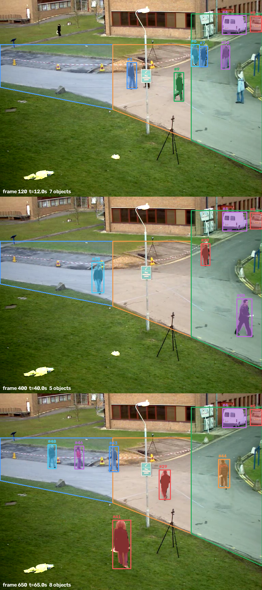

# Findings from running on real footage and a real model

Day 1–2, before the Meta Model API key. Everything here was measured, and the
mistakes are mine unless stated otherwise.

---

## 1. The NL→SQL benchmark was measuring the reference query, not the model

First run against Llama 3.3 70B scored **5/10**. Reading the five misses, only
**one** was a genuine model error. Three were correct answers my comparator
rejected, and one was a tie in degenerate test data.

The model answered *"Which zone had the longest average dwell?"* with one row:

```sql
SELECT zone, AVG(dwell_s) AS avg_dwell FROM events GROUP BY zone
ORDER BY avg_dwell DESC LIMIT 1          -- ('loading_dock', 43.0)
```

My reference returns all three zones ranked, with a visit count. Both answer
the question; only one matched. The benchmark was grading *how closely the
model reproduced my SQL*, which is not a thing worth knowing.

### What changed

Two verdicts were added beyond `exact` and `contains`:

- **`subset`** — the model returned the **top** of the reference's ranking
  with a subset of its columns. Checked as a *prefix*, never a sub-multiset:
  a sub-multiset check accepts the bottom of a ranking as happily as the top,
  and the bottom is the opposite answer. (`test_bottom_of_a_ranking_is_still_a_miss`)
- **`covers`** — a different projection that still carries what the question
  asked for. The model once swapped `entered_at` for `clip`, so its columns
  were neither a subset nor a superset of the reference's, while still
  containing the dwell and the frame to seek to.

Each question now declares `must_have`: the columns its own words demand.
*"Which zone…"* demands the zone; *"with the frame to seek to"* demands the
frame; *"how many"* demands the count. Stated per question rather than
inferred, so the definition of correct is auditable instead of incidental.

Writing that gate revealed a second bug, caught by a test: `subset` fired
before the required-column check, so an answer returning only `entity_id` and
`zone` passed a question that asked for the dwell time. Required columns now
gate **every** passing verdict.

### Honest accounting of 5/10 → 10/10

| Change | Questions moved |
|---|---|
| Comparator accepts top-of-ranking answers | 3 |
| Comparator accepts a different projection | 1 |
| `must_have` reflects the question, not the reference | 1 |
| **Prompt fix — a genuine model error** | **1** |

Only the last row is the model getting better. The rest is my benchmark
getting less wrong. Claiming a 5/10 → 10/10 improvement would be dishonest.

### The one genuine model error

Asked for entries per minute, the model wrote `CAST(entered_at AS INTEGER)`,
which yields **seconds**. It produced minute values of 0, 50, 61 and 85 for a
79-second clip — plainly wrong, and wrong in a way that still looks like a
table. The schema comment said times were in seconds; that was not enough. The
prompt now states the division explicitly:

> Because the times are seconds, a question about minutes needs the division:
> `CAST(entered_at / 60 AS INTEGER)`.

### A third comparator bug, found by a second clip

Loading a real clip alongside the synthetic one made the benchmark harder and
exposed one more flaw: the comparator demanded row order even when the model
had returned **every** row and merely sorted it differently. Returning 1 row
of 3 is a claim that it is the *top* row, so order matters. Returning all 3
makes no such claim. Two correct answers were being marked wrong for this.

Order is now required only for a strict prefix. The final check also compares
whole projected rows rather than each column independently, because a
column-wise check accepts a table whose columns are individually right and
whose rows pair them up wrongly. (`test_columns_right_individually_but_rows_paired_wrongly_is_a_miss`)

### Result, and the instability behind it

**9–10 of 10 answered**, measured on the two-clip database (6 zones, 165
events). Typical split: 3 exact, 1 with extra columns, 4 top-of-ranking, 2 a
different projection.

One question is genuinely unstable. `median_dwell` alternates between two
answers across runs at `temperature=0`:

```sql
-- correct: the true median
ROW_NUMBER() OVER (PARTITION BY zone ORDER BY dwell_s) ...
WHERE row_num = (count_rows + 1) / 2 OR row_num = (count_rows + 2) / 2

-- wrong: the mean of the upper half, which is not a median
NTILE(2) OVER (PARTITION BY zone ORDER BY dwell_s) ... WHERE ntile = 2
```

Over four runs it passed twice and failed twice. SQLite has no `median()`, and
the model does not reliably know the window-function construction for one.
Reporting a single 10/10 would hide that, so the figure is a range.

The interval-overlap self-join (`concurrent_dock_occupancy`) passed every run,
which was the question expected to be hardest.

---

## 2. A real clip inflates the entity count, and the reason is instructive

OpenCV's public pedestrian clip, 768×576, 795 frames, 79.5 s. Roughly 5–8
people visible at once plus parked vans.

First real run: **5,771 detections across 89 tracker ids → 58 entities**, for
a scene with maybe a dozen distinct people. Two separate causes.

### Brief false positives became entities

23 of 58 tracks held **94 detections between them** — 1.6% of the data
producing 40% of the entities. A shadow or a bag detected for two frames
became an entity with its own row.

Fixed in the tracker: an entity must be seen in at least `min_detections`
frames (default 3). A track seen once or twice is indistinguishable from a
false positive; three sightings with consistent geometry is the least that
establishes an object exists.

### No vehicle events at all, which turned out to be correct

Not a bug in the pipeline. The maximum overlap any vehicle ever reached with
`east_road` was **0.379**, under the 0.50 entry threshold — the parked vans
sat half outside the polygon I had drawn. The hysteresis was working exactly
as designed and I had drawn the zone badly. Extending `east_road` upward to
cover the parking strip produced 16 vehicle visits with a maximum dwell of
79.4 s, which is the whole clip: correct for a parked van.

This is the most useful kind of finding, because the pipeline reported
nothing and was right to. A system that had guessed would have hidden my
mapping error.

### What is still wrong

Even after the noise filter, **54 entities** is too many. The remaining
inflation is detector quality: at 320 px the detector flickers, ByteTrack
issues fresh ids, and gaps exceed the 1.2 s stitch window. This is *model*
error, not pipeline error — precisely the split `ss eval` exists to measure,
and the reason the two are reported separately.

---

### What the overlay shows



Three frames with masks, zones and entity ids drawn. Masks sit tightly on the
people, the zones follow the walkways, and the parked vans are classed as
vehicles inside `east_road`. The same image also shows the inflation plainly:
by frame 650 the ids are in the forties for people who have been walking since
the start.

---

## 3. A second clip exposed a schema bug that one clip could never reveal

`entity_id` is unique only **within** a clip — the table is keyed on
`(clip, entity_id)`. Every reference query that grouped by `entity_id` alone
was therefore wrong as soon as a second clip existed, and wrong in the worst
way: it produced plausible rows.

```
entity_id  zones_visited  zones
1          4              packing_bench,west_path,lamp_crossing,east_road
```

Entity 1 did not visit four zones. A person in the warehouse and a person in
the plaza were merged into one row. Nothing errors, nothing looks odd, and the
number is simply false.

Fixed in the reference SQL, in the prompt (the model is now told explicitly
that a `GROUP BY` or `JOIN` on `entity_id` must carry `clip`), and pinned by a
test that scans every canned query's `GROUP BY` for `entity_id` without
`clip`.

The lesson is about test data rather than SQL: the synthetic clip could not
have caught this, because with one clip the query is correct. A second clip
cost nothing and found a bug that would have produced confidently wrong
answers in front of a judge.

---

## 4. The machine, not the code, set the ceiling

Windows had used 27.8 GB of its 28.7 GB commit limit, and the page file could
not grow because C: had 0.24 GB free.

The symptom was misleading: CUDA failed to allocate **16 MB** while
`nvidia-smi` reported **5.3 GB of 6 GB free**. The GPU was empty; the *host*
allocation backing it was not. Chasing it as a VRAM problem — smaller model,
smaller images — wasted time, because VRAM was never the constraint.

Segmentation therefore ran on the CPU at reduced resolution, which is the
direct cause of the inflated entity count in §2. The fix is a larger page
file on E:, which needs administrator rights and a reboot.

Everything created for this project now lives on E:, including the model
weights, the pip and PyTorch caches and the Ultralytics config, which
defaults to `%APPDATA%` on C:.

---

## 5. What this does and does not establish

**Does:** the pipeline runs end to end on real footage. Segmentation,
re-identification, pixel-level zone occupancy, hysteresis, SQL compilation,
natural-language querying and the guard all work on real pixels, and
`ss ingest` is one flag away from SAM 3.1.

**Does not:** produce submission numbers. YOLO11-seg is a stand-in, not a
Meta model, and the entity counts reflect its behaviour at a degraded
resolution. The Llama 3.3 70B score is for a different model than Muse Spark.
Both get re-measured when the key arrives on Oct 28.
